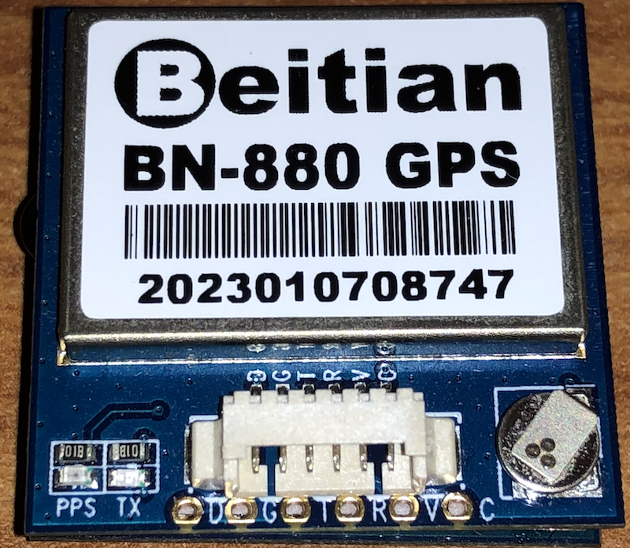

# Dashboard System Design

## Evaluation Kit Electronic Devices

The below table are for components used for evaluating the feasibility of the Dashboard System.

| Device                      | Model Number    | Specification / Description                        |
|-----------------------------|-----------------|----------------------------------------------------|
| ESP32                       | ESP32 WROVER E  | 4 MB flash, 8 MB PSRAM                             |
| TFT Display                 | CNBTR39         | 2.8", 240 x 320                                    |
| Micro SD Card Reader        | N/A             | TF Memory Card Reader Module SPI                   |
| 3 Axis Gyro + Accelerometer | MPU-6050 GY-521 |                                                    |
| GPS                         | BN-880          | 4M flash, HMC5883 Compass                          |
| CAN Bus Module              | N/A             | MCP2515 CAN Bus Module TJA1050 Receiver SPI Module |
| RGB LEDs                    | WS2812B 5050    | Lights on strip                                    |

## Evaluation Kit Wiring Table

### TFT Display (ILI9341 2.8" 240x320) to ESP32

| **Device Pin** | **ESP32 Pin** | **Colour** | **Device Specific** |
|----------------|---------------|------------|---------------------|
|     5V         |     5V        |   RED      |         NO          |
|     GND        |     GND       |   BLACK    |         NO          |
|     CS         |     G0        |   WHITE    |         YES         |
|     RESET      |     G15       |   WHITE    |         YES         |
|     DC         |     G3        |   WHITE    |         YES         |
|     SDI (MOSI) |     G23       |   WHITE    |         NO          |
|     SCK        |     G18       |   WHITE    |         NO          |
|     LED        |     5V        |   RED      |         NO          |
|     SDO (MISO) |     G19       |   WHITE    |         NO          |

### TFT Display (ILI9486 3.5" 480x320) to ESP32

Note this is currently used without any other devices connected to the ESP32

| **Device Pin** | **Prototype Board** | **ESP32 Pin** | **Colour** |
|----------------|---------------------|---------------|------------|
|     RESET      |     D19             |     X         |            |
|     3.3V       |     D18             |     3.3V      |            |
|     5V         |     D17             |     5V        |            |
|     GND        |     D16             |     GND       |            |
|     GND        |     D15             |     GND       |            |
|     X          |     D14             |     X         |            |
|     LCD_RD     |     D0              |     G2        |            |
|     LCD_WR     |     D1              |     G4        |            |
|     LCD_RS     |     D2              |     G15       |            |
|     LCD_CS     |     D3              |     G33       |            |
|     LCD_RST    |     D4              |     G32       |            |
|     F_CS       |     D5              |     X         |            |
|     X          |     A15             |     X         |            |
|     X          |     A14             |     X         |            |
|     SD_SCK     |     A13             |     X         |            |
|     SD_D0      |     A12             |     X         |            |
|     SD_D1      |     A11             |     X         |            |
|     SD_SS      |     A10             |     X         |            |
|     LCD_D1     |     A9              |     G13       |            |
|     LCD_D0     |     A8              |     G12       |            |
|     LCD_D7     |     A7              |     G14       |            |
|     LCD_D6     |     A6              |     G27       |            |
|     LCD_D5     |     A5              |     G16       |            |
|     LCD_D4     |     A4              |     G17       |            |
|     LCD_D3     |     A3              |     G25       |            |
|     LCD_D2     |     A2              |     G26       |            |
|     X          |     A1              |     X         |            |
|     X          |     A0              |     X         |            |

### Micro SD Card to ESP32

| **Device Pin** | **ESP32 Pin** | **Colour** | **Device Specific** |
|----------------|---------------|------------|---------------------|
|     5V         |     5V        |   RED      |        NO           |
|     GND        |     GND       |   BLACK    |        NO           |
|     MISO       |     G19       |   YELLOW   |        NO           |
|     MOSI       |     G23       |   YELLOW   |        NO           |
|     SCK        |     G18       |   YELLOW   |        NO           |
|     CS         |     G5        |   YELLOW   |        YES          |

### 3 Axis Gyro to ESP32

| **Device Pin** | **ESP32 Pin** | **Colour** | **Device Specific** |
|----------------|---------------|------------|---------------------|
|     5V         |     5V        |   RED      |        NO           |
|     GND        |     GND       |   BLACK    |        NO           |
|     SCL        |     G22       |   BLUE     |        NO           |
|     SDA        |     G21       |   BLUE     |        NO           |

### GPS to ESP32

Note the numbers are from left to right based on the barcode sticker on the GPS module.

| **Device Pin** | **ESP32 Pin** | **Colour** | **Device Specific** |
|----------------|---------------|------------|---------------------|
|   D - SDA      |     G21       |   BLACK    |        NO           |
|   G - GND      |     GND       |   WHITE    |        NO           |
|   T - TX       |     G35       |   GREEN    |        YES          |
|   R - RX       |     G34       |   RED      |        YES          |
|   V - 5V       |     5V        |   YELLOW   |        NO           |
|   C - SCL      |     G22       |   BLUE     |        NO           |

### RGB LEDs to ESP32

| **Device Pin** | **ESP32 Pin** | **Colour** | **Device Specific** |
|----------------|---------------|------------|---------------------|
|     5V         |     5V        |   RED      |        NO           |
|     GND        |     GND       |   BLACK    |        NO           |
|     Din        |     G4        |   GREEN    |        YES          |

### CAN Bus Module to ESP32

| **Device Pin** | **ESP32 Pin** | **Colour** | **Device Specific** |
|----------------|---------------|------------|---------------------|
|     5V         |     5V        |   RED      |        NO           |
|     GND        |     GND       |   BLACK    |        NO           |
|     CS         |     G2        |   WHITE    |        YES          |
|     MISO       |     G19       |   BLUE     |        NO           |
|     MOSI       |     G23       |   BLUE     |        NO           |
|     SCK        |     G18       |   WHITE    |        NO           |
|     INT        |     GX        |   N/A      |        X            |

### ESP32 (WROVER-E) Pin Utilisation

| **Device Pin** | **Used** | **Usage**                       |
| -------------- | -------- | ------------------------------- |
|     3.3V       |    NO    |   Power (For LCD Future Update) |
|     EN         |    NO    |   N/A                           |
|     G36/VP     |    NO    |   N/A                           |
|     G39/VN     |    NO    |   N/A                           |
|     G34        |    YES   |   GPS RX                        |
|     G35        |    YES   |   GPS TX                        |
|     G32        |    NO    |   LCD RST (Future Update)       |
|     G33        |    NO    |   LCD CS (Future Update)        |
|     G25        |    NO    |   LCD 8 bit bus (Future Update) |
|     G26        |    NO    |   LCD 8 bit bus (Future Update) |
|     G27        |    NO    |   LCD 8 bit bus (Future Update) |
|     G14        |    NO    |   LCD 8 bit bus (Future Update) |
|     G12        |    NO    |   LCD 8 bit bus (Future Update) |
|     GND        |    YES   |   Power                         |
|     G13        |    NO    |   LCD 8 bit bus (Future Update) |
|     G9/SD2     |    NO    |   LCD WR (Future Update)        |
|     G10/SD3    |    NO    |   LCD RD (Future Update)        |
|     G11/CMD    |    NO    |   LCD RS (Future Update)        |
|     5V         |    YES   |   Power                         |
|     5V         |    YES   |   Power                         |
|     GND        |    YES   |   Power                         |
|     G23        |    YES   |   MOSI                          |
|     G22        |    YES   |   SCL                           |
|     G1/TX      |    NO    |   N/A                           |
|     G3/RX      |    YES   |   TFT DC                        |
|     G21        |    YES   |   SDA                           |
|     GND        |    YES   |   Power                         |
|     G19        |    YES   |   MISO                          |
|     G18        |    YES   |   SCK                           |
|     G5         |    YES   |   SD CS                         |
|     GND        |    YES   |   Power                         |
|     GND        |    YES   |   Power                         |
|     G4         |    YES   |   LED Din                       |
|     G0         |    YES   |   TFT CS                        |
|     G2         |    YES   |   CAN CS                        |
|     G15        |    YES   |   TFT RST                       |
|     G8/SD1     |    NO    |   N/A                           |
|     G7/SD0     |    NO    |   N/A                           |
|     G6/CLK     |    NO    |   N/A                           |
|     GND        |    YES   |   Power                         |
