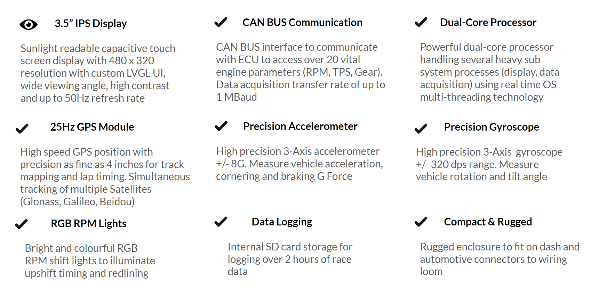
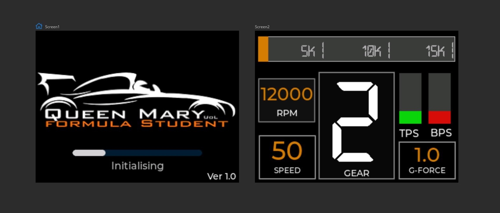

# Dashboard

## Introduction

This repository is for a Formula Student Dashboard project.

The dashboard is an compact, 3.5" display, GPS & logger module, designed to provide the driver with vital real-time data from engine ECU and sensors via CANBUS. The uses range from engine diagnostics to analysis on driver performance post race.

Housed in a lightweight enclosure, the dashboard features an sunlight readable (>800 cd/m2 luminance) bright IPS display viewable from wide angle range with high contrast.

The display comes with a capacitive touch screen to provide the driver with additional configurability, and with custom UI created using LVGL (Light & Versatile Embedded Graphics Library).

## Main Features

## Images

## Repository Structure

    .
    ├── Dashboard_GUI
    ├── Dashboard_Program
    ├── Documentation (Contains instructions and information about the project)
    ├── Images
    ├── Libraries (Directory for custom libraries needed for Arduino code)
    ├── Release Hex
    ├── Testing Programs
    └── README.md (This document)

## Documentation

- [Dashboard Evaluation Kit - Setup to prototype devices on a breadboard](./DashboardEvaluationKitSystemDesign.md)
- [Dashboard Pinout - Pinout for the Dashboard PCB](./DashboardPinout.md)
- [IDE Setup - Setup for IDEs used for software development](./Setup.md)
- [RaceBox BLE Protocol Description - Information for reading and writing data to the RaceBox module](./RaceBox%20BLE%20Protocol%20Description%20rev%208.pdf)
- [S Series CAN Stream Generic - Information DTA S series ECUs CAN BUS](./S%20Series%20CAN%20Stream%20Generic.pdf)
- [S60 Simulator Pinout - Pinout for S60 ECU Simulator](./S60SimulatorPinout.md)
- [SquareLine Studio Setup - SquareLine studio setup for GUI development](./SquareLineStudioSetup.md)

## Project Contributors

Bhargav Maniar\
Raymond Zhen
